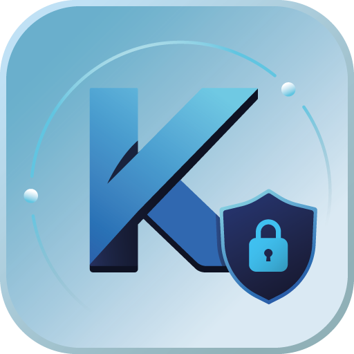

<p align="center">
  
</p>

<h1 align="center">KMAruda LAPS</h1>

<p align="center">
  <b>A native Windows client for reading LAPS passwords from Active Directory.</b><br>
  LDAP and Windows LAPS APIs from Rust, a React interface, no PowerShell and no RSAT.
</p>

<p align="center">
  
  
  
  
  
  
</p>

---

> [!NOTE]
> **Status: 2.1.0.** The native LDAP path, password rotation, audit journal and
> encrypted Windows LAPS decryption are implemented and covered by unit tests.
> Actual KDS decryption has not been verified against a live domain in CI:
> run the checklist in [docs/TESTING.md](docs/TESTING.md) in your own domain
> before rolling the build out.

## Why

Support engineers need the local administrator password of a managed machine
now, not after installing RSAT and remembering a cmdlet. The 1.x tool did that
by generating PowerShell scripts, which tripped SIEM rules, needed the
`ActiveDirectory` module and passed the password through a child process.

2.x does the same work in-process:

| 1.x (PowerShell)                        | 2.x (native)                                        |
| --------------------------------------- | --------------------------------------------------- |
| `Get-LapsADPassword` / `Set-LapsADPasswordExpirationTime` | `ldap3` queries and LDAP modify                    |
| generated temporary `.ps1` files         | no scripts, no child processes                      |
| `-EncodedCommand`, `powershell.exe`      | `lapsutil!DecryptNormalMode` (Windows LAPS DLL)     |
| password in a child process command line | password stays in Rust memory (`Zeroizing`)         |
| journal written by the UI                | journal written by Rust commands                    |

## Features

- Search by short name (`WS01`), FQDN (`ws01.company.ru`) or IP address
  (reverse DNS through the Windows resolver), scoped to computer objects only.
- Read all three storage flavours: legacy `ms-Mcs-AdmPwd`, plain Windows LAPS
  `msLAPS-Password`, and encrypted `msLAPS-EncryptedPassword`.
- Decrypt encrypted Windows LAPS through the same native Windows LAPS API that
  `Get-LapsADPassword` uses, under the account entered at sign-in.
- Reset the password expiration to "now" or set an explicit date; the card is
  re-read after the LDAP modify.
- Sign in with an AD account (simple bind) or with the current Windows session
  (SASL GSSAPI/SSPI). Credentials live in memory only.
- LDAPS or StartTLS, optional certificate verification bypass for internal CAs,
  with the choice recorded in the audit event.
- Local audit journal with gzip rotation and cross-archive pagination.
- Russian and English interface, light/dark/system themes, Montserrat typography.

## Requirements

| Component | Requirement |
| --- | --- |
| Application | Windows 10/11 or Windows Server 2019+ with WebView2 Runtime |
| Directory | Domain-joined machine, LDAPS (636) or StartTLS reachable |
| Encrypted LAPS | Windows LAPS component, KDS decryption right, route to a domain controller |
| Build | Node.js 20+, Rust 1.90+ (MSVC), Visual Studio Build Tools with C++ |

The Windows LAPS component ships with Windows 11 23H2+, and with Windows 10
21H2/22H2, Windows Server 2019 and Windows Server 2022 after the
[April 11, 2023 update](https://support.microsoft.com/help/5025221). Windows 10
is out of mainstream support; encrypted LAPS there is an ESU scenario.
See [docs/COMPATIBILITY.md](docs/COMPATIBILITY.md) for the full matrix.

## Install

Download the NSIS installer from
[Releases](https://github.com/KirillGrachev/LAPS/releases/latest) and run it.
Enterprise deployment can use the MSI from the same release, and the portable
ZIP runs without installation. The installer bundles the WebView2 bootstrapper
and does not contain any PowerShell or `.ps1` payload; the only NSIS hook closes
a running instance before an upgrade.

First run:

1. Open **Settings → Active Directory** and enter the LDAP URL, for example
   `ldaps://dc1.company.ru:636`. StartTLS is forced for `ldap://`.
2. Leave **Base DN** empty to use the domain's `defaultNamingContext`, or set
   an OU explicitly.
3. Press **Test** — the app binds and reads rootDSE.
4. Sign in with your domain account or with the current Windows session.
5. Search for a computer. The card shows the password, its flavour and
   expiration; copying it is written to the audit journal.

## AD permissions

The account needs delegated rights, not domain admin:

- read `ms-Mcs-AdmPwd` and/or `msLAPS-Password`, and `msLAPS-EncryptedPassword`
  for encrypted storage;
- the **Read password** and **Decrypt** KDS rights for encrypted storage;
- **Reset msLAPS password expiration** (or write on
  `ms-Mcs-AdmPwdExpirationTime`) to reset the expiration.

Read [docs/ADMIN.md](docs/ADMIN.md) for the exact ACLs, KDS delegation and a
least-privilege group layout.

## How decryption works

The encrypted attribute is an MS-ADA2 2.66 envelope: an 8-byte FILETIME, a
4-byte size, 4 reserved bytes, then a DPAPI-NG block at offset 16. The app
tries the documented layout plus a few tolerated variants, then calls
`DecryptNormalMode` from `lapsutil.dll` under a token created with
`LogonWithCredentials` for an explicit sign-in. For SSO, or when `lapsutil.dll`
is unavailable or rejects the block, `NCryptUnprotectSecret` is used as a
fallback. With an explicit account the fallback is deliberately disabled so the
password is never decrypted under a different identity than the operator chose.

These exports are not a documented Microsoft API. A Windows update, WDAC or
AppLocker policy, or a security product may block them; the card then shows the
exact Win32/HRESULT diagnostic while expiration management keeps working.

## Security

- No credentials or passwords are written to disk. The sign-in password lives
  in `Zeroizing<String>` in process memory and is wiped at logout and exit.
- AD transport is encrypted: LDAPS, or StartTLS forced for `ldap://`. Plain
  LDAP is rejected. Certificate verification is on unless explicitly disabled.
- The decrypted API buffer is zeroized before it is freed. The password is then
  held in IPC payloads, React state and the clipboard, which the app does not
  control.
- Password fields never enter the audit journal; details carry the operation
  mode, error codes and diagnostics. The journal is local plain text, editable
  by a local administrator, and is not tamper-evident.
- No shell, no PowerShell and no `tauri-plugin-shell`. External links go through
  an allow-list (`http`, `https`, `mailto`) and the OS handler.

Read [SECURITY.md](SECURITY.md) for the threat model and known limitations.

## Build

```powershell
npm ci
npm run tauri dev
```

The release installer:

```powershell
npm run tauri build
```

`src-tauri/target/release/bundle/nsis/` receives the `.exe`. Exact prerequisites,
the signing story and the installer layout are in [docs/BUILD.md](docs/BUILD.md).

## Checks

```powershell
npm run format:check
npm run lint
npm run typecheck
npm test
npm run build

cargo fmt --manifest-path src-tauri/Cargo.toml -- --check
cargo clippy --manifest-path src-tauri/Cargo.toml --all-targets --locked -- -D warnings
cargo test --manifest-path src-tauri/Cargo.toml --locked
```

CI runs the same checks on Linux and Windows, plus the no-PowerShell policy
scan, CodeQL, dependency review and OSV. Details: [docs/TESTING.md](docs/TESTING.md).

## Project layout

| Path | Responsibility |
| --- | --- |
| `src/` | React interface: screens, contexts, hooks, IPC adapter, i18n |
| `src-tauri/src/commands/` | Thin Tauri commands; every LAPS operation is audited here |
| `src-tauri/src/services/ldap/` | Transport: connect, TLS, bind, escaping, entry normalization |
| `src-tauri/src/services/laps/` | Domain: query, parse, decrypt, expiration, time |
| `src-tauri/src/services/config/` | Secret-free configuration model and atomic store |
| `src-tauri/src/services/audit.rs` | Journal with gzip rotation and pagination |
| `docs/` | Architecture, build, administration, testing and the frozen v1 archive |

## Documentation

- [Architecture](docs/ARCHITECTURE.md)
- [Build and packaging](docs/BUILD.md)
- [AD administration and permissions](docs/ADMIN.md)
- [Compatibility matrix](docs/COMPATIBILITY.md)
- [Troubleshooting](docs/TROUBLESHOOTING.md)
- [Testing](docs/TESTING.md)
- [Release process](docs/RELEASE.md)
- [Privacy](docs/PRIVACY.md)
- [Changelog](CHANGELOG.md)

## Contributing and support

Read [CONTRIBUTING.md](CONTRIBUTING.md) before opening a pull request; all
participation is covered by the [Code of Conduct](CODE_OF_CONDUCT.md).
Use [SUPPORT.md](SUPPORT.md) for questions and [SECURITY.md](SECURITY.md) for
vulnerabilities — never a public issue with a password or a domain name.

## License

MIT. See [LICENSE](LICENSE). Third-party components are listed in
[docs/THIRD_PARTY_NOTICES.md](docs/THIRD_PARTY_NOTICES.md).
